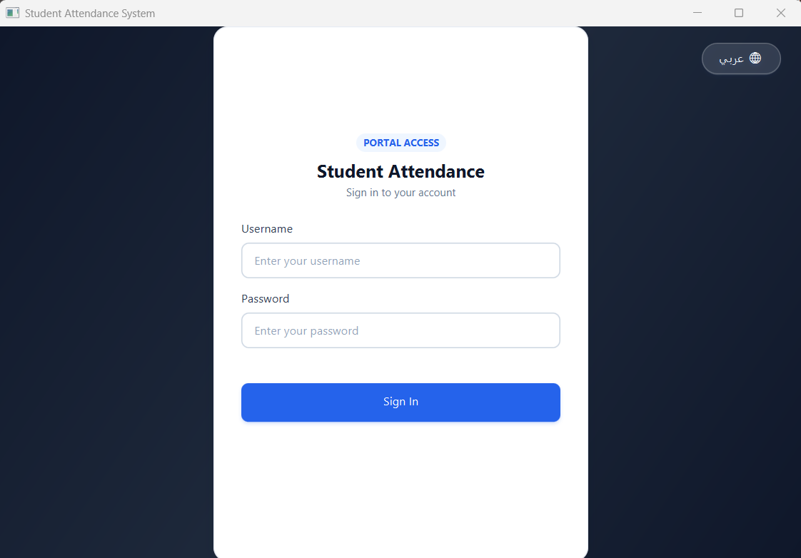
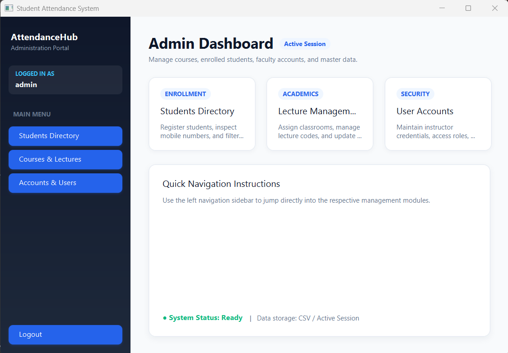
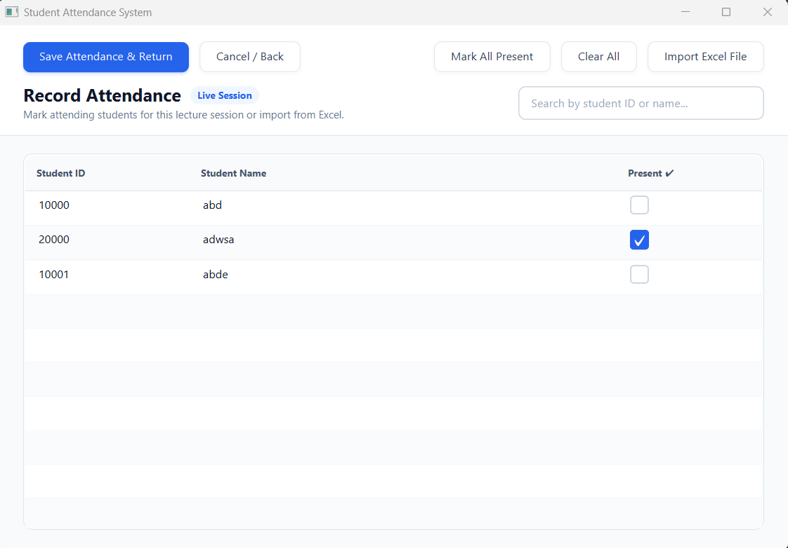
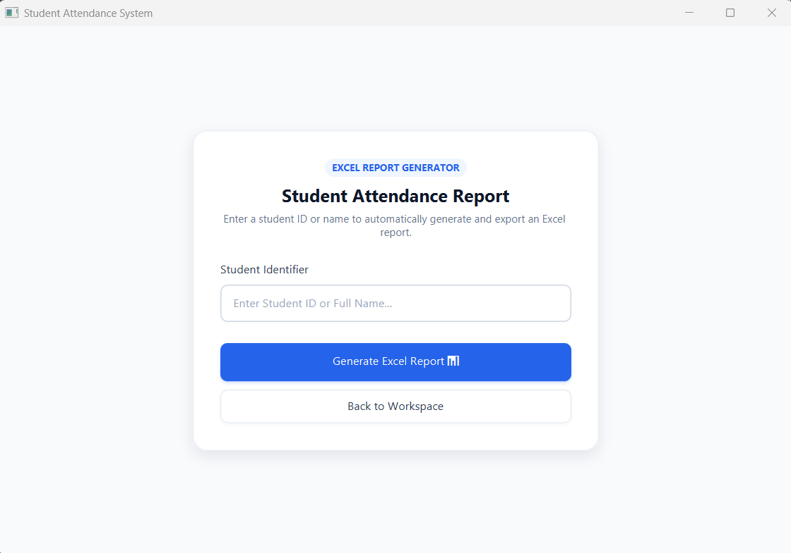

<!--
  © 2026 Hani Al-khateeb. All Rights Reserved.
  Unauthorized copying or distribution of this project, via any medium, is
  strictly prohibited. Proprietary and confidential. See LICENSE for details.
-->

<div align="center">

> **⚠️ PROPRIETARY SOFTWARE — ALL RIGHTS RESERVED**
>
> © 2026 **Student Attendance System** · Developed by **Hani Al-khateeb** · All Rights Reserved.
> Unauthorized copying, redistribution, or modification of this project is strictly prohibited.
> See the [LICENSE](./LICENSE) file for full terms.

</div>

---

# StudentAttendance

**A polished desktop workspace for managing students, lectures, and attendance.**

StudentAttendance is a JavaFX application that brings everyday academic administration into one place. Administrators can maintain student records, staff accounts, and lecture assignments, while teachers can take attendance for their assigned lectures and create Excel attendance reports.

## Highlights

- **First-run administrator setup** with sign-in for administrator and teacher accounts.
- **Student directory** to add and manage student records, with filters for ID, name, mobile number, and residence.
- **Account management** for application users and teacher access.
- **Lecture management** for lecture details, assigned teachers, and classroom information.
- **Teacher workspace** for viewing students, choosing assigned lectures, and taking attendance.
- **Flexible attendance marking** with student search, a “mark all present” action, and Excel-list import to preselect students.
- **Excel attendance reports** searchable by student ID or name, including lecture, teacher, and attendance details.
- **CSV-backed local data** for accounts, students, lectures, and attendance/enrollment records.
- **Credential protection** using salted PBKDF2-HMAC-SHA-256 password hashes.
- **JavaFX screens styled with FXML and CSS**, with an exit prompt to save or discard changes.

## Tech Stack

| Component | Version / details |
| --- | --- |
| Java | JDK 17 or later (project compiles with `--release 17`) |
| JavaFX | 21.0.2 (`javafx-controls`, `javafx-fxml`) |
| Build | Maven Wrapper, configured for Maven 3.8.5 |
| CSV | Apache Commons CSV 1.11.0 |
| Excel | Apache POI 5.2.5 (`poi`, `poi-ooxml`) |
| Tests | JUnit Jupiter 5.9.2 |

The JavaFX Maven plugin (0.0.8) resolves the platform-specific JavaFX dependencies when building and running the app.

## Prerequisites

- **JDK 17 or later** installed and available on your `PATH`.
- An internet connection the first time you build, so Maven can download the build and runtime dependencies.
- A desktop environment capable of running JavaFX.

You do not need to install Maven separately; the project includes Maven Wrapper scripts.

## Getting Started

### 1. Clone the repository

```bash
git clone https://github.com/AbdAlsharief/StudentAttendance.git
cd StudentAttendance
```

### 2. Run the application

On macOS or Linux:

```bash
./mvnw clean javafx:run
```

On Windows PowerShell:

```powershell
.\mvnw.cmd clean javafx:run
```

The first run may take a little longer while Maven downloads dependencies.

## First-Run Login

There is **no hard-coded `admin` / `admin` account**. On a clean installation with no saved accounts, the login screen prompts you to create the first administrator account. Choose your own username and a password of **at least 12 characters**. After setup, sign in with those credentials.

If the application finds existing account data, use the credentials for an account already stored in that data.

## Data and Reports

- Application CSV data is stored in the `.studentattendance` directory under your home directory (for example, `~/.studentattendance/` on macOS/Linux or `%USERPROFILE%\.studentattendance\` on Windows).
- Existing CSV files in the application's working directory may be migrated into that data directory the first time the app reads them.
- Attendance reports are generated as `StudentReport.xlsx` in the application's working directory. When supported by the desktop environment, the app opens the generated report automatically.
- The attendance Excel import accepts `.xls` and `.xlsx` workbooks and uses student IDs from the first sheet to preselect matching students.

## Screenshots

| Login & First-Run Setup | Administrator Dashboard |
| :---: | :---: |
|  |  |
| *Login and first-run setup screen* | *Administrator control panel* |

| Attendance-Taking Screen | Excel Report & Import Screen |
| :---: | :---: |
|  |  |
| *Live attendance tracking and session roster* | *Excel report generation and data matching* |

## Project Structure

```text
src/main/java/com/example/studentattendance/
├── controller/   # JavaFX screen controllers
├── models/       # Account, student, lecture, and attendance models
├── security/     # Password hashing
└── storage/      # CSV persistence

src/main/resources/com/example/studentattendance/
├── views/        # FXML screens
└── styles/       # Application CSS
```

## Author

**Hani Al-khateeb**

---

<p align="center">
  Built to make student and attendance management clearer, faster, and easier to maintain.
</p>

---

## Copyright & License

<div align="center">

| Field | Details |
|---|---|
| **Copyright** | © 2026 Hani Al-khateeb |
| **Project** | Student Attendance System (StudentAttendance) |
| **License** | Proprietary — All Rights Reserved |
| **Contact** | Hani Al-khateeb |

> **All source code, FXML views, stylesheets, resource bundles, and associated assets within this repository are the exclusive intellectual property of Hani Al-khateeb.**
>
> No part of this project may be reproduced, distributed, sublicensed, sold, or used in derivative works without prior explicit written permission from the author.
> See the full [`LICENSE`](./LICENSE) file for complete terms and restrictions.

**© 2026 Student Attendance System · Developed by Hani Al-khateeb · All Rights Reserved.**

</div>
